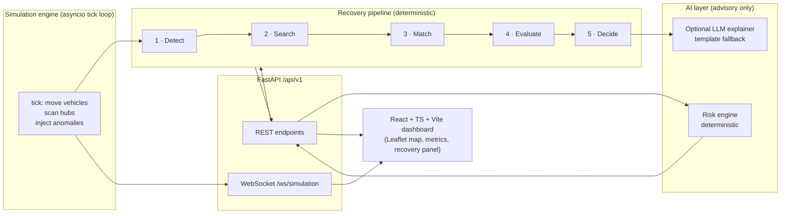

# SH-205 — Architecture

## High-level architecture



- **Backend** — Python 3.11+, FastAPI, Pydantic v2, plain `asyncio` tick loop
  (1 real second = 1 simulated hour by default). All state is in-memory
  (`app/state.py: World`), structured so a Postgres repository could replace
  the dicts without touching pipeline code.
- **Frontend** — React 18 + TypeScript + Vite; react-leaflet over OpenStreetMap.
- **Real-time** — WebSocket pushes enveloped events (`event_id`, `timestamp`,
  `seq`, `type`, `payload`); the client falls back to REST polling if the
  socket is down, and auto-reconnects with exponential backoff.

## Domain model

Typed Pydantic v2 models with explicit state machines (`app/models.py`):

```
Shipment:  CREATED → IN_TRANSIT → AT_HUB → DELIVERED
                         ↘ DELAYED ↘ MISPLACED / DISRUPTED
             MISPLACED | DISRUPTED → RECOVERING → RECOVERED
             CANCELLED, RECOVERED, DELIVERED are terminal
Assignment: PENDING → IN_TRANSIT → COMPLETED | MISSED
                    → CANCELLED | REPLACED (terminal)
Vehicle:    IN_TRANSIT ↔ AT_HUB → COMPLETED
Hub:        ACTIVE ↔ CLOSED
```

`set_status()` validates every transition against `SHIPMENT_TRANSITIONS` /
`ASSIGNMENT_TRANSITIONS`; illegal moves raise `InvalidTransition` (HTTP 409).
There is no code path from a disruption to DELIVERED.

## Recovery workflow

```mermaid
sequenceDiagram
    participant Sim as Simulation
    participant Det as Detect
    participant API as /api/v1
    participant Opt as Match→Evaluate→Decide
    participant UI as Dashboard

    Sim->>Det: tick telemetry (stale scan / deviation / missed connection)
    Det->>API: shipment → MISPLACED + RecoveryEvent(reason, severity)
    UI->>API: POST /optimize {shipment_id}
    API->>Opt: search → match → evaluate → decide (top 3)
    Opt-->>UI: ranked options + real numbers + explanations
    UI->>UI: operator reviews (human-in-the-loop confirm)
    UI->>API: POST /recover {shipment_id, option_rank}
    API->>API: per-shipment lock; idempotency guard
    API->>API: original assignment → REPLACED, capacity freed
    API->>API: recovery legs created (PENDING, is_recovery_leg)
    API-->>UI: WS recovery_applied
    Sim->>Sim: legs board at pickup, transfer, deliver
    Sim-->>UI: shipment RECOVERING → RECOVERED, metrics live
```

**Consistency guarantees** (§5): exactly one active assignment chain per
shipment; the original carrier's capacity is freed exactly once; duplicate
`/recover` calls are no-ops; multi-hop recoveries create one traceable leg per
vehicle segment.

## Optimization pipeline

1. **Search** — vehicles IN_TRANSIT/AT_HUB with `spare_kg > 0`, excluding
   routes touching CLOSED hubs.
2. **Match** (hard constraints, all enforced): capacity `spare >= weight`;
   direct route order (pickup index strictly before destination); multi-hop
   via ACTIVE transfer hub with both legs capacity-feasible; ETA ≤ deadline +
   buffer.
3. **Evaluate** — min-max normalized objectives; each score ∈ [0,1] with
   division-by-zero guards:

   `score = w_cost·cost + w_time·time + w_priority·priority + w_co2·co2 + w_risk·risk`

   CO₂ is always a **comparison against the dedicated-trip baseline**
   (baseline − 10% marginal), never a bare emission number. Weights are
   validated (`>= 0`, sum `> 0`); invalid requests get HTTP 422.
4. **Decide** — top-3 by score with a template explanation built from the
   actual computed numbers, plus machine-readable `score_breakdown`.

## AI architecture

The optimizer is deterministic; AI is advisory and never bypasses hard
constraints.

| Component | Type | Guarantees |
|---|---|---|
| `ai/risk_engine.py` | Feature-based logistic risk model, fixed published weights | Deterministic; every output decomposes into named factors |
| `ai/explainer.py` (template) | Rule-based prose from real numbers | Always available |
| `ai/explainer.py` (LLM) | Optional OpenAI call that rephrases the template payload | Off without `AI_PROVIDER`+`AI_API_KEY`; any failure/timeout falls back to template; never performs actions |

```
LLM text  ──► display only
Optimizer ──► constraint-checked ──► the only actionable decision path
```

## WebSocket architecture

- Envelope: `{event_id, timestamp, seq, type, entity_id, payload}`; `seq` is
  monotonic and the client drops out-of-order `state` frames.
- Server pongs client pings (RTT measurement); dead sends are pruned.
- Client: exponential-backoff reconnect (1s→8s), REST polling fallback at 2s
  while offline; the header shows `🟢 live` vs `🟡 polling`.

## Failure handling

| Failure | Behavior |
|---|---|
| Unknown shipment/vehicle/hub | HTTP 404 structured error + `request_id` |
| Invalid weights / malformed body | HTTP 422 with error code |
| Duplicate recovery | Idempotent no-op (200, `idempotent: true`) |
| Concurrent recovery for same shipment | Per-shipment `asyncio.Lock` |
| Illegal state transition | `InvalidTransition` → HTTP 409 |
| Unexpected exception | Logged with stack (server-side), sanitized 500 to client |
| WebSocket drop | Client reconnects; REST polling keeps UI alive |
| No feasible candidates | Honest empty state in UI; event stays PENDING/EXPIRED |

## Security model

- No secrets in code; all configuration via env vars (`.env.example` documents
  every key; `.env` is git-ignored). The LLM key, if provided, is read from the
  environment and never logged or returned by any endpoint.
- CORS is configurable (`CORS_ORIGINS`); methods limited to GET/POST/OPTIONS.
- All request bodies are Pydantic-validated with length/range constraints.
- Chaos/admin endpoints are simulation-only by design (no real-world actuation
  exists to protect); an auth layer is the documented v2 step.
- Structured errors never leak stack traces or internal paths.

## What is simulated vs real

| Real (implemented logic) | Simulated (clearly labeled) |
|---|---|
| Detection rules, matching, scoring, ranking | GPS/telemetry feed (tick loop) |
| State machines, idempotency, locking | Carrier systems, real traffic |
| CO₂/cost math vs dedicated baseline | Money and emissions constants |
| WS envelopes, reconnect, polling fallback | Hub operations (instant scans) |

## Production-scale notes

At 30 vehicles / 100 shipments the full pipeline runs in well under a
millisecond. Beyond that: spatial indexing for proximity queries, a
precomputed route graph, persistence (Postgres + migrations), async I/O on the
repository boundary, and an OR-Tools/MILP solver for fleet-wide joint
optimization are the documented next steps.
